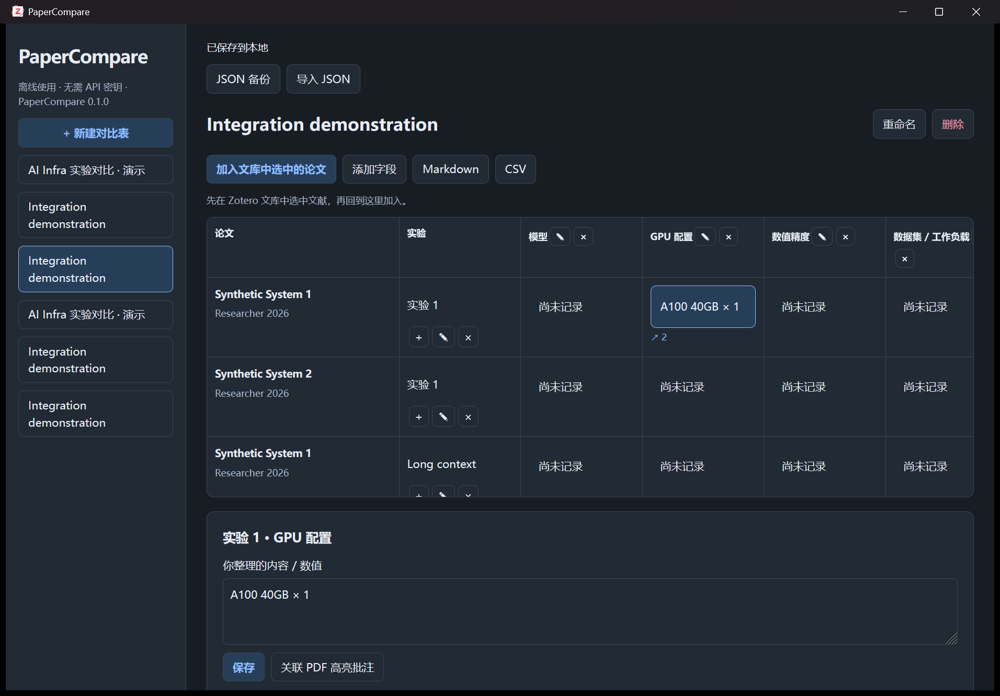

# PaperCompare

**在 Zotero 中，用可追溯的原文证据整理、比较多篇论文。**

[English](README.md) · 预览版 **0.1.0** · MIT 开源 · 免费离线 · 无需 API 密钥



## 能做什么

- 创建对比表：提供通用、AI Infra 模板，支持自定义、重命名和删除字段。
- 加入多篇论文：同一论文可以记录多组实验，避免把不同配置的结果混在一起。
- 人工整理单元格：同时关联多条 Zotero PDF 高亮，保存原文快照和页码。
- 定位证据：点击原文，打开对应 PDF 批注；来源失效时保留快照并提示。
- 导出 Markdown、CSV，以及可重新导入的完整 JSON 备份。

## 安装与开始使用

从 [Releases](https://github.com/luxun-spec/zotero-papercompare/releases/latest) 下载 **[papercompare-0.1.0.xpi](https://github.com/luxun-spec/zotero-papercompare/releases/download/v0.1.0/papercompare-0.1.0.xpi)**，也可按下方步骤自行构建。

1. Zotero 菜单 **工具 → 插件 → 齿轮 → Install Plugin From File**，选择下载的 `.xpi` 文件。
2. 打开 **工具 → PaperCompare**，点击“新建对比表”。
3. 回到 Zotero 文库，选中要比较的论文；返回插件，点击“加入文库中选中的论文”。
4. 在 PDF 阅读器中使用 Zotero 原生高亮保存文字。
5. 点击对比表中的单元格，填写你整理的内容，点击“保存”。
6. 点击“关联 PDF 高亮批注”，勾选证据并完成。一个单元格可关联多条。
7. 点击“定位原文”返回来源；使用工具栏导出结果。

每行实验旁的 **+** 用于增加同一论文的另一组实验；铅笔用于重命名，× 用于删除并确认。

“尚未记录”只表示你还没有填写。插件不自动判定论文是否未报告、也不判断实验能否公平比较。数值和单位均由你记录。

## 保存、备份与限制

已实际验证 **Windows + Zotero 10.0.6**；安装兼容范围暂限定 `10.0.*`。macOS、Linux 和旧版本 Zotero 的界面未经验证。

- 数据保存到 Zotero 数据目录中的 `papercompare.json`，并保留上一份有效状态 `.bak`。
- 不直接写 Zotero 数据库、不修改论文元数据和原生批注。
- 文件损坏时停止编辑，需显式恢复有效备份。请定期导出 JSON，它比只保留上次保存的 `.bak` 更适合长期备份。
- 保存失败时，修改暂留窗口；可以重试保存或导出草稿 JSON。插件被停用时会尝试写入 `papercompare-recovery-draft.json` 恢复草稿。
- Markdown 包含证据摘录；CSV 只包含表格值；JSON 保留完整插件数据。
- JSON 不包含 PDF，也不会跨文库、跨机器重新匹配条目。证据跳转依赖原文献、原附件、原批注仍存在。
- 个人文库的 Markdown 可包含 Zotero 跳转链接；群组文库的导出证据暂以文本形式保留。
- 更新清单和安装包托管于 GitHub Releases，并提供 SHA-256 校验。此前使用本地开发包的用户需手动安装一次公开版，以替换开发更新地址；可在 Zotero 插件管理器中开启自动更新。

## 开发

需要 Node.js 24，进入项目目录后执行：

```sh
npm ci
npm test
npm run typecheck
npm run build
```

安装包生成到 `dist/papercompare-0.1.0.xpi`。使用插件不需要安装 Node.js。

隔离集成测试：

```powershell
powershell -ExecutionPolicy Bypass -File scripts/launch-test.ps1 -Build
```

脚本使用 `work/` 下独立配置和数据目录，只创建合成测试论文及 PDF，不使用个人文库。结果写入 `work/test-data/integration-result.json`。生产构建移除了执行测试脚本的入口。

详细说明见 [设计](docs/superpowers/specs/2026-10-16-papercompare-design.md)、[实施计划](docs/superpowers/plans/2026-10-16-papercompare.md)和[验证记录](docs/verification.md)。
